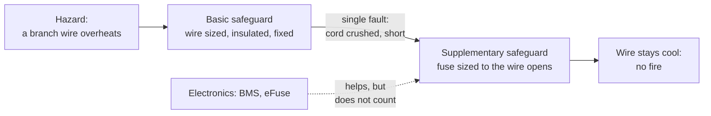

The rest of the code follows from the five rules on this page. Read them first.

## What can go wrong

Every circuit in a system built to this code is **extra-low voltage**: 60 V DC or less. At these
voltages the main dangers are not electric shock. They are:

- **Energy.** A lithium battery can push thousands of amps into a short circuit. That melts
  metal, burns skin and sets cables on fire.
- **Fire.** Overloaded wire, loose terminals, arcing connectors, and the battery itself.
- **Damage to devices.** Too much voltage on an outlet, for example when a converter fails.

## SYS-1.1 Extra-low voltage only

**must** - Every circuit stays at or below 60 V DC, including the solar panels at their coldest
(see [GEN-1.1](/code/solar-array/#gen-11-panel-voltage-in-the-cold)). No circuit connects to AC
mains wiring.

*Why:* at 60 V DC or less, a dry, intact circuit is safe to touch (IEC 62368-1 class ES1, and SELV
in IEC 61140). That keeps the system simple enough for community installers. Higher voltages need
different parts, skills and rules, which this code does not cover.

## SYS-1.2 Two safeguards for every hazard

**must** - Each hazard has a **basic safeguard** that protects in normal use, and a
**supplementary safeguard** that still protects after any single fault. One fault never defeats
both.

*Why:* this is the hazard-based model of IEC 62368-1. Any part can fail. The question for every
hazard is: when this part fails, what still protects?

*Example:* a branch wire. Basic safeguard: the wire is sized for its load, insulated and fixed in
place. Supplementary safeguard: a fuse sized to the wire, which opens if the wire is overloaded or
shorted.

## SYS-1.3 The safeguard that counts fails safe

**must** - The supplementary safeguard for overcurrent is a device that fails safe: a fuse, or a
DC circuit breaker with the right ratings. Electronic protection (a battery's BMS, an electronic
fuse, a converter's current limit) is welcome, but it does not count as the supplementary safeguard.

*Why:* electronic switches fail by shorting, which is exactly the fault they should protect
against. A fuse fails open. Electronic protection still helps: it acts faster, resets, and keeps
the fuse from blowing in everyday faults.

## SYS-1.4 Protect the wire, not the device

**must** - Each overcurrent device is sized to protect the **wire** it feeds: the design current
is at most the device rating, and the device rating is at most what the wire can carry
(IB ≤ In ≤ Iz). See [DIST-1](/code/overcurrent-protection/).

*Why:* the wire is what burns. A device's own fuse protects the inside of the device, not the
cable feeding it.

## SYS-1.5 The system protects up to the outlet

**must** - From the battery to every outlet, the system provides its own protection. It never
relies on the devices plugged into it to protect the wiring.

*Why:* a short in a cord or wall cable, a loose connector or a wrong outlet voltage happens before
the device, which never sees it. And nobody controls what gets plugged in.

## SYS-1.6 No bare live parts outdoors or in wet places

**must** - Outdoors, in bathrooms, in animal shelters and anywhere wet, every live part is
insulated or enclosed, whatever its voltage.

*Why:* wet skin conducts far better. The touch-safe limit drops to 30 V DC outdoors (IEC 62368-1,
2018 edition on) and to 15 V in wet conditions (IEC 61140). A 24 V system charges up to 29.2 V,
and solar panels reach 50-60 V: both are above the wet limit.
