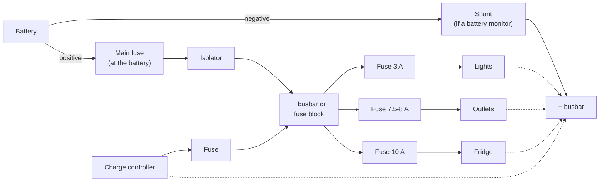
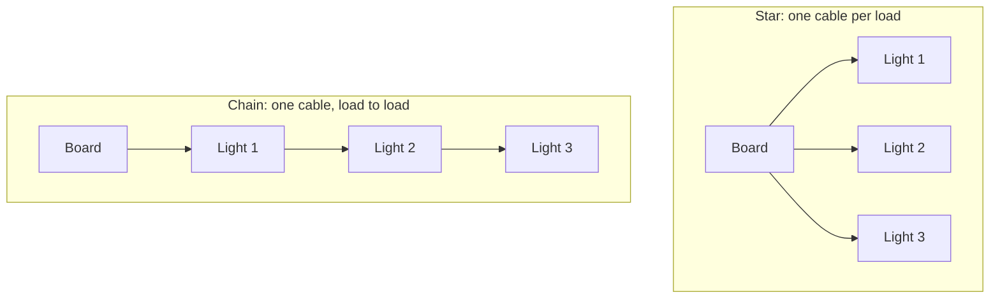

This page is for the installer laying out the cables from the battery to every light and outlet.
It gives recommended specs you can buy almost anywhere, then the layout and the checks. The rules
behind it are in [DIST-1 Overcurrent protection](/code/overcurrent-protection/) and
[DIST-2 Wiring](/code/wiring/).

:::danger
Open the battery isolator and take out the main fuse before you work on the board. Follow the
[connection order](/install/connection-order/) when you power up.
:::

## The layout

Power goes from the battery through one main fuse and the isolator to a positive busbar. Each
branch has its own fuse on that busbar. All negatives come back to one negative busbar.

- **No fuse in the negative.** Keep the negative continuous; fuse and switch the positive.
- **Battery monitor:** if you fit a shunt, the battery negative is the **only** cable on the
  battery side of the shunt. Every load and charger negative goes to the system side, or the
  monitor cannot count it.
- **Busbars are bare metal.** Cover them so a dropped tool cannot touch them
  ([DIST-5.2](/code/enclosures/#dist-52-no-reachable-live-parts)).
- The cable feeding the board carries the sum of all branches: size it to the main fuse
  ([STO-2.4](/code/battery-fuse-and-isolator/#sto-24-size-the-main-fuse-to-its-cable)).

## Recommended branch specs

For a 24 V system. Each branch is one of the three
[branch classes](/code/overcurrent-protection/#dist-15-branch-classes). The fuse decides the
smallest wire; the length may make it bigger.

| Branch class | Fuse | Cable to buy (indoors) | Longest run at 3 % drop | Longer runs |
|---|---|---|---|---|
| **Limited** (lights, chargers, up to 2.5 A) | 3 A blade fuse (violet) | 2-core flexible cord, **1.0 mm²** (H05VV-F 2×1.0) | 8 m | 1.5 mm² to 12 m; 2.5 mm² to 20 m |
| **Standard** (outlets, fans, TV, up to 5 A) | 8 A (see note) | 2-core flexible cord, **1.5 mm²** | 6 m | 2.5 mm² to 10 m; 4 mm² to 16 m |
| **Power** (fridge, tools, up to 7.5 A) | 10 A blade fuse (red) | 2-core flexible cord, **1.5 mm²** | 4 m | 2.5 mm² to 7 m; 4 mm² to 11 m; 6 mm² to 16 m |

- Lengths are one way, from the board to the farthest load, at the full branch current
  ([DIST-2.2](/code/wiring/#dist-22-voltage-drop)). Lights and fans may drop 10 %: their runs can
  be about 3 times longer. At 12 V, halve every length.
- In practice, **2.5 mm² for every standard and power branch** is the simple choice: it covers
  most rooms and is sold everywhere.

:::note[8 A fuses]
Blade fuses, the commonest small DC fuse, come in 7.5 A and 10 A but **not 8 A**. Until the code
settles this, use a 7.5 A blade fuse (brown) for a standard branch, or an 8 A fuse of another type
that is rated for DC at 32 V or more.
:::

### Bundled cables and hot roofs

A cable's rating assumes it is alone in air at 30 °C. Cables bundled together, or run through a
hot roof space, carry less:

| Condition | Multiply the rating by |
|---|---|
| Air at 35 °C / 40 °C / 45 °C | 0.91 / 0.82 / 0.71 |
| 3 circuits bundled together | about 0.70 |
| 6 circuits bundled together | about 0.57 |

A 1.5 mm² cord is rated 16 A alone. Six of them bundled under a 40 °C roof carry only about
16 × 0.57 × 0.82 = **7.5 A**: less than an 8 A or 10 A fuse lets through. **Where more than three
branch cables run together, or cables cross a hot roof, use 2.5 mm².** (The grouping factors come
from an unofficial copy of IEC 60364-5-52, not the standard itself.)

## What cable to buy

| Cable (code on the sheath) | What it is | Use it for |
|---|---|---|
| **H05VV-F** (or 60227 IEC 53) | Round flexible cord, fine strands, PVC | **Indoor branches and cords.** The best all-round choice. |
| **H07RN-F** (or 60245 IEC 66) | Heavy rubber flexible cable | **Outdoor runs**, cords walked on, wet places |
| **H1Z2Z2-K** or "PV1-F" solar cable | Single core, tinned copper, UV and water resistant | **Panel cables**, any run in sun or buried; one red and one black |
| **H07V-K** single core | Flexible single core, no sheath | Inside conduit, boxes, and short links on the board |
| Automotive cable (FLRY, GPT, TXL) | Single core, thin insulation, rated 60 V | Short links in the battery box; in conduit inside a building |
| Welding cable (H01N2-D) | Very flexible, thick rubber | Battery and inverter leads |

Avoid:

- **Solid-core house wire** (H07V-U, twin-and-earth, NYM). Solid copper cracks under crimps and
  works loose in screw terminals; all the solar and marine guides read ask for stranded cable
  ([DIST-2.3](/code/wiring/#dist-23-stranded-copper-cable)). Twin-and-earth also has a thin bare
  earth wire that tempts people to use it as the negative.
- **Unmarked "speaker" or zip cord.** It is often copper-clad aluminium with no rating. Use it only
  if it is marked copper with a voltage and current rating.
- **Copper-clad aluminium (CCA)** of any kind: see [Buying parts](/plan/buying-parts/#why-cca-cable-matters).

### Check the cable before you use it

The size printed on a cable is a name, not a measurement. The standard defines each size by its
**maximum resistance**. Fake cable is sold in many countries: in the UK, cable sold as 1.5 mm²
measured 0.8 mm², with a forged quality mark; in Nigeria, regulators keep seizing substandard
cable. Test each reel:

1. At the far end of the reel, twist the two cores together.
2. Set the multimeter to its lowest ohms range. Touch the probes together and note the reading.
3. Measure across the two cores at the near end. Subtract the reading from step 2.
4. Compare with the table. More than 10 % above the line means the cable is undersized or not
   copper. Do not use it.

| Size | Most a 100 m two-core reel may read (20 °C) |
|---|---|
| 0.75 mm² | 5.2 Ω |
| 1.0 mm² | 3.9 Ω |
| 1.5 mm² | 2.7 Ω |
| 2.5 mm² | 1.6 Ω |
| 4 mm² | 1.0 Ω |
| 6 mm² | 0.66 Ω |

For a 50 m reel, halve the value. In a hot place add 4 % per 10 °C above 20 °C. Also scrape the end
of a strand with a knife: silver under the copper colour is aluminium. Weighing the box is not
reliable: some fake boxes contain extra weight.

## Fuses or breakers on the branches

| | Blade fuse in a fuse block | DC circuit breaker (DIN rail) |
|---|---|---|
| Where to buy | Every auto-parts shop | Solar and electrical dealers |
| Rated | 32 V DC, 1000 A interrupting (good for 12 V and 24 V, **not 48 V**) | Check the label: DC voltage, DC breaking capacity |
| Fast on a short at the end of a long thin cable | Yes | Often **not**: see below |
| Reset | Replace the fuse (keep spares) | Switch back on |

A breaker trips at once only when the current is many times its rating: 4 to 7 times for a B-curve
DC breaker, 7 to 15 times for a C-curve. A short at the end of 20 m of 1.5 mm² cable at 24 V can
draw only about 45 A, because of the cable's own resistance. A 10 A C-curve breaker then trips on
its slow heat element, not at once. A blade fuse at 3.5 times its rating opens in 0.02-0.5 seconds.
**For small branches, fuses are the better choice.** If you use breakers, choose B-curve, DC-rated
ones and wire them with the polarity printed on them: many DC breakers are damaged if wired the
wrong way round.

Colour code for blade fuses: 3 A violet, 5 A tan, 7.5 A brown, 10 A red, 15 A blue, 20 A yellow.

## Star or chain

| | Star | Chain |
|---|---|---|
| Cable used | More | Less |
| Voltage drop at the last load | Smaller | Bigger: the first section carries every load |
| A fault | Affects one load | Can affect everything after it |
| Use for | Outlets, fridges, long runs | Lights and other small loads close together |

*Worked example:* three 1 A lights on 1.5 mm² cable at 5, 10 and 15 m from the board, 24 V. Chained
on one cable, the last light sees 0.80 V drop (3.3 %) from 15 m of cable. Star-wired, it sees
0.40 V (1.7 %), using 30 m of cable. A chain is fine for lights if every section is the same size
and the branch fuse protects that size. **Do not wire rings** (a loop back to the board): a broken
leg cannot be seen, and the other leg then carries everything.

## Running the cable

From the solar home system quality standard used in many rural electrification programmes:

- **Fix cable on the surface every 15-20 cm** with clips or in trunking. Where a fire could make
  clips fail (escape routes, ceilings), use metal clips or trunking.
- **Overhead cable** between buildings: lowest point at least **2.8 m** above the ground, with a
  support wire for long spans.
- **Buried cable:** at least **0.5 m** deep, in conduit or with a cover, outdoor-rated cable only.
- **Thatch and other roofs that burn:** cable in non-flammable conduit.
- **Switches** near the door, about **1.2 m** above the floor. Use switches rated for DC: an AC
  switch may not break a DC arc.
- **Joints** only in a junction box, with screw terminals, lever connectors or crimps. No twisted
  and taped joints, no wire nuts, no soldering on site
  ([DIST-2.5](/code/wiring/#dist-25-crimped-not-twisted)).
- **Ferrules** on every stranded wire end that goes into a screw terminal.
- **Through walls and roofs:** a sleeve or gland, sealed with UV-resistant sealant, and a drip loop
  outside.
- Keep DC and AC cables apart: separate conduit and boxes, or a barrier between them.

Lever connectors such as WAGO 221 are rated 32 A and take fine-stranded wire from 0.14 to 4 mm²:
good for joints in lighting branches.

## Boxes and IP ratings

The IP code on a box says what it keeps out. First digit: solids and fingers. Second digit: water.

| Code | Keeps out | Use it |
|---|---|---|
| IP20 | Fingers | Dry indoor rooms, inside another box |
| IP44 | Wires, splashing water | Indoors where dust and insects are few |
| IP54 | Most dust, splashing water | **Indoors, recommended** where dust or insects are common |
| IP65 | All dust, water jets | **Outdoors** |

Solar wiring guides differ (indoor IP20 to IP54, outdoor IP55 to IP65); these are the safer
values. Use plastic boxes for junctions; the distribution board itself must be a fire enclosure
([DIST-5.1](/code/enclosures/#dist-51-fire-enclosure)).

## When parts are hard to find

- **No flexible cord?** Single-core flexible cable (H07V-K) in conduit is a good substitute. If
  only solid house wire is sold, use it only for fixed runs in conduit that never move, ending in
  junction boxes with pressure-plate or lever terminals. Change to stranded cable before any crimp
  lug, fuse holder or device. Write the reason in the system documents.
- **No DC breakers?** Blade fuses and fuse blocks from any auto-parts shop are better anyway at
  12 and 24 V.
- **No busbar?** A blade fuse block with a built-in negative bus does both jobs.
- More: [When parts are missing](/plan/when-parts-are-missing/).
