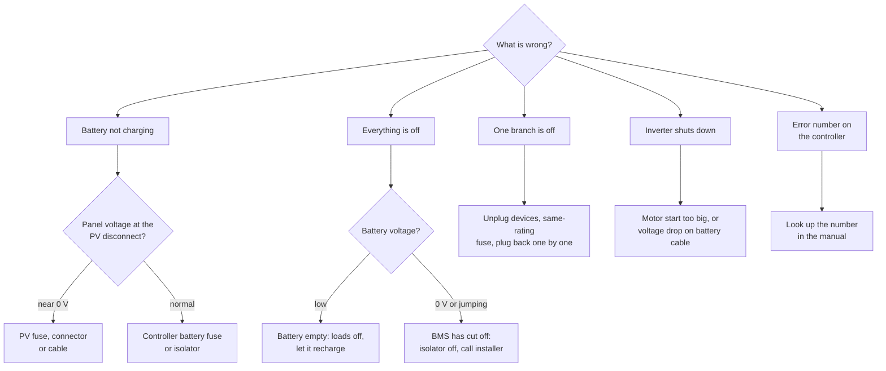

Something has stopped working. This page helps you find out what, with a multimeter and the
controller's display. Start with the [regular checks](/maintain/regular-checks/): many problems
show there first.

:::caution
Look and measure, but do not open the battery box or the distribution board unless you are the
installer. Switch the battery isolator off before you touch any terminal. If you smell burning or
see melted insulation, switch everything off and call the installer: do not troubleshoot.
:::

## Where to start

Each box is explained in the sections below. [The battery is not charging](#the-battery-is-not-charging) ·
[Loads cut out](#loads-cut-out) · [The inverter shuts down](#the-inverter-shuts-down) ·
[Controller errors](#controller-errors).

## What you need

- A multimeter (any cheap one) that reads DC volts.
- The [wiring diagram](/code/labels-and-documents/#sys-21-wiring-diagram) and the notebook with
  past readings.
- The manuals for the charge controller, the battery and the inverter.

## Three measurements

Set the meter to **DC volts** (V with a straight line). Red probe on +, black on −.

1. **Battery voltage.** At the battery terminals, or at the controller's battery terminals.
2. **Panel voltage.** At the PV disconnect, in daylight. With the disconnect open, you read the
   panel's open-circuit voltage (Voc): close to the label value in sun, lower in cloud.
3. **Voltage drop.** Measure the battery voltage at the battery, then at the device or the
   controller, **while current is flowing**. The difference is lost in the wires and joints. More
   than 3 % (0.7 V at 24 V, 0.4 V at 12 V) means a cable that is too thin, or a loose or corroded
   joint ([DIST-2.2](/code/wiring/#dist-22-voltage-drop)). To find which joint, measure across each
   joint in turn: the bad one shows most of the drop and is usually warm.

**Checking a fuse:** take it out first. Set the meter to continuity (beep) or ohms. A good fuse
beeps or reads close to 0 Ω. A fuse that blew has a cause: find it before you put in a new one.

## The battery is not charging

The controller shows 0 A, or the battery voltage does not rise during the day.

| What you find | Likely cause | What to do |
|---|---|---|
| Night, heavy cloud, or panels shaded or dirty | Not enough light | Clean the panels; check for new shade. Wait for sun. |
| Battery nearly full, current low in the afternoon | Normal: the controller slows down when the battery is full | Nothing. |
| Cold morning, below about 5 °C | The battery's BMS or the controller stops charging in the cold ([GEN-2.4](/code/charge-controller/#gen-24-no-charging-in-the-cold)) | Normal. It starts again when the battery warms. |
| Panel voltage near 0 V at the PV disconnect | PV fuse blown, connector apart, cable damaged, or a panel reversed | Check the PV fuses and connectors from the panel down. |
| Panel voltage only a little above the battery voltage | The controller needs the panels about 5 V above the battery to start | Panels too small for the battery voltage, or heavily shaded. Ask the installer. |
| Controller shows a voltage, but the voltage at the battery is different | Controller's battery fuse blown, or the isolator open | Check the fuse and the isolator. Before replacing a blown fuse, check the battery cables are not reversed. |
| Error number on the display | See [Controller errors](#controller-errors) | |

## Loads cut out

Lights or outlets go off, alone or all together.

:::danger
Never replace a fuse with a bigger one, or bridge it with wire. The fuse protects the wire from
catching fire ([DIST-1.2](/code/overcurrent-protection/#dist-12-fuse-no-bigger-than-the-wire)).
:::

| What you find | Likely cause | What to do |
|---|---|---|
| Everything off, battery voltage low | The battery is empty. The BMS or the controller's load output switched off to protect it. | Normal protection. Turn loads off and let the panels recharge. If it happens often, the system uses more than it makes: see [Energy and load budgets](/plan/energy-and-load-budgets/). |
| Everything off, battery voltage reads 0 V or jumps | The BMS has disconnected the battery (very low, too hot, or a short) | Switch off all loads and the isolator, then call the installer. |
| One branch off | A blown fuse or tripped breaker on that branch | Unplug that branch's devices, replace the fuse with the **same** rating, plug devices back one at a time. If it blows again, the last device or its cord is faulty. |
| Goes off when something big starts (fridge, pump) | The starting current is too high for the output, or the voltage sags on a thin cable | Measure voltage drop while it starts. Big motor loads should be fed from the battery side, not from a controller's load output. |
| Works, then flickers or goes off when warm | A loose joint heating up | Switch off and tighten (installer), then check with your hand for heat under load. |

## The inverter shuts down

Most small inverters switch off when the battery voltage falls too low, or when a device asks for
too much power. Many try again after about 30 seconds, and stay off after a few tries.

- **When a motor starts** (fridge, pump, power tool): the start takes more power than the inverter
  can give. Check the inverter's peak rating.
- **When the battery is low**: recharge it. If the battery is full and it still happens, the
  battery cables are too thin or loose: the voltage at the inverter drops under load. Measure the
  voltage drop at full load (more than 3 % is too much).

## Controller errors

Look up the number in your controller's manual. For Victron SmartSolar controllers, the common
ones are:

| Error | Meaning | What to do |
|---|---|---|
| #1 | Battery too hot | Let it cool; check the battery has air around it. |
| #2 | Battery voltage too high | Another charger is set too high, or the controller's battery voltage is set wrong (for example 12 V on a 24 V battery). Installer checks the settings ([GEN-2.3](/code/charge-controller/#gen-23-set-for-the-battery)). |
| #17 | Controller too hot | Clear space around its heat sink; move it out of the sun. |
| #26 | Terminal too hot | A loose cable at the controller. Switch off and tighten to the manual's torque. |
| #33 | Panel voltage too high | Clears by itself when the voltage drops. If it happens on cold mornings, the array breaks [GEN-1.1](/code/solar-array/#gen-11-panel-voltage-in-the-cold): installer. |
| #38, #39 | PV input shut down to protect the battery | Usually a wrong battery voltage setting. Reset: PV off, battery off, wait 3 minutes, battery on, then PV on ([connection order](/install/connection-order/)). |

## What the battery voltage tells you

A lithium iron phosphate (LiFePO₄) battery keeps almost the same voltage from full to nearly
empty. Its voltage tells you only roughly how full it is. Measure after it has rested for an hour
with no charging and no loads.

| Rest voltage, 12 V pack | Rest voltage, 24 V pack | Roughly |
|---|---|---|
| 13.4 V or more | 26.8 V or more | Nearly full |
| 13.0-13.3 V | 26.0-26.6 V | Half to most |
| 12.8-12.9 V | 25.6-25.8 V | About a quarter |
| 12.0 V | 24.0 V | Nearly empty: recharge now |
| below 12.0 V | below 24.0 V | Empty: the BMS may switch off soon |

While charging, the voltage reads higher (up to about 14.2 V or 28.4 V); under a heavy load it
reads lower. A battery monitor (a meter that counts amp-hours in and out) is the accurate way.

## When to get help

Call the installer if:

- a fuse blows again after you replaced it;
- anything is hot, smells of burning, or the battery is swollen, leaking or hissing;
- the BMS disconnects the battery and it does not come back after charging;
- an error on the controller comes back after a reset.

Fixes inside the battery, the controller or the inverter are for the maker or a trained repairer.
