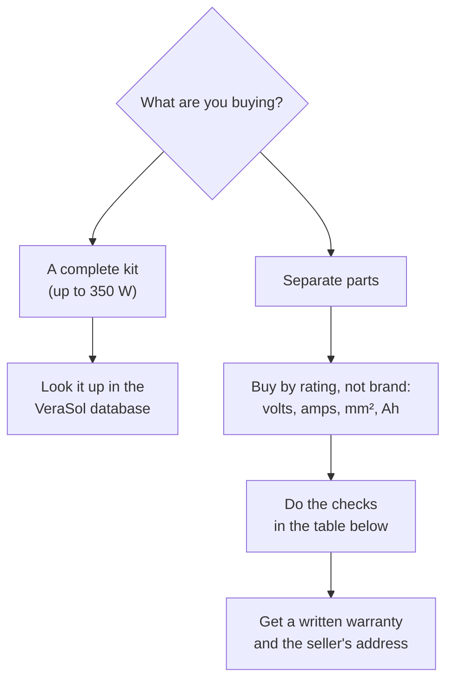

The parts this wiki recommends are common, but so are fakes and look-alikes. This page tells you
what you will usually find for sale, where, and how to check it before you pay. It is for
installers and NGO buyers in places where parts come from local shops and market stalls.

## What the market sells

Most off-grid solar sold worldwide is small. In 2024, the companies in the GOGLA industry
association sold 9.3 million kits: 5.6 million solar lanterns, 1.9 million small multi-light kits
and 1.7 million solar home systems. Fewer than 27 000 of those had 100 W of panel or more.

Systems the size of this wiki's [Size B and C](/plan/system-sizes/) are mostly **built from
separate parts**: a panel, a battery, a controller and lights, bought separately and put together
by a local vendor. Studies put this "mix-and-match" share at half or more of home systems in some
countries. So the parts you buy, and the checks on this page, decide most of the system's quality.

## Where to find each part

| Part | Where it is usually sold | Watch for |
|---|---|---|
| **Fuses and fuse holders** | Auto-parts and truck-parts shops: blade fuses, MIDI and ANL fuses, rated 32 V | Fakes that look right but do not blow on time. 32 V fuses suit 12 V and 24 V, **not 48 V** ([DIST-1.3](/code/overcurrent-protection/#dist-13-rated-for-dc-at-the-system-voltage)). |
| **Cable and lugs** | Auto-parts shops (battery cable), electrical wholesalers (cable by mm²) | Copper-clad aluminium (CCA) sold as copper; cable thinner than its label. |
| **Panels** | Solar dealers, electrical shops, market stalls | Watts on the label higher than the panel's size allows. |
| **Charge controllers** | Solar dealers, market stalls, online | "MPPT" controllers that are really PWM. |
| **Batteries** | Solar dealers (lithium, "solar" or tubular lead-acid), auto-parts shops (car batteries), online | Capacity much lower than the label. See [When parts are missing](/plan/when-parts-are-missing/) for lead-acid. |
| **USB chargers and cables** | Mobile-phone shops | No safety mark. In one test, none of 7 cheap mains chargers had one. |
| **Complete kits** | Kit and pay-as-you-go (PAYGo) companies | Check the VeraSol database. Closed kits are hard for anyone else to repair. |
| **DC appliances** (fans, TVs, fridges) | Solar dealers, kit companies | Few shops stock efficient DC appliances; ask for tested models. |

## Checks before you pay

Lab tests of best-selling solar products that had no quality certificate found that **all 17**
failed basic quality standards. Nine of 16 claimed more battery capacity than they had, by 35 % on
average, and 88 % had no warranty. These checks catch the commonest problems.

| Part | Check | A warning sign |
|---|---|---|
| **Kit** | Find the brand and model in the [VeraSol database](https://verasol.org/database/). The product should look the same as the one in the database. | Not listed, or listed only under "previously certified". |
| **Panel** | Measure the frame. A modern panel makes at most about 220-250 W per square metre of panel. | A "100 W" panel smaller than about 0.4 m² (for example 60 × 67 cm). |
| **Panel** | In full sun, measure the open-circuit voltage (Voc) with a multimeter and compare it with the label. | Far below the label in strong sun. |
| **Charge controller** | While it charges a battery that is not full, measure the panel voltage at the controller. | Panel voltage within about 1 V of the battery voltage: the "MPPT" is working as a PWM controller. |
| **Lead-acid battery** | Weigh it. Good deep-cycle batteries weigh about 25-32 kg per kWh (a 12 V, 100 Ah battery is 1.2 kWh, so about 30-38 kg). | Much lighter than that for the Ah on the label. |
| **Lead-acid battery** | Measure the voltage after it has rested. A new flooded battery reads about 12.7 V when full (25.5 V for 24 V). | Below about 12.1 V (24.2 V): half empty or old stock. |
| **Lithium battery** | Run a known load for a timed period and measure how long it lasts. | Capacity far below the label. Any small cylindrical cell (18650) labelled far above about 3 500 mAh is fake. |
| **Cable** | Cut or scrape the end of a strand. Count the strands; check the size printed on the sheath. | A silver-grey core under the copper colour: CCA. |
| **Fuses** | Buy from a shop that sells known brands; compare with a genuine one. | Light, badly printed, no maker's name or rating on the fuse. |
| **Anything** | Ask for a written warranty and where to bring it for repair. | No warranty, a seller who will not be there next year. |

### Why CCA cable matters

Copper-clad aluminium cable has an aluminium core with a thin copper skin. It conducts only about
63 % as well as copper: a cable sold as 25 mm² CCA carries about what 16 mm² copper does. A fuse
chosen for the label size then does not protect it, and the joints corrode where aluminium meets
copper lugs. The code requires copper ([DIST-2.3](/code/wiring/#dist-23-stranded-copper-cable)).

## Buy for repair

When a system breaks, the hardest part is often finding a spare. In a 2026 World Bank survey, only
about a third of customers with a fault felt it was properly repaired, and closed boxes were the
hardest to fix. Parts sold by rating in every town (a 10 A blade fuse, 2.5 mm² copper cable, an
M8 ring lug) can always be replaced. That is why the code names parts by rating, not by brand.

- Write the rating, not only the brand, on the [wiring diagram](/code/labels-and-documents/#sys-21-wiring-diagram).
- Keep [spare fuses](/code/labels-and-documents/#sys-24-spare-fuses) of every rating in the system.
- Prefer a controller and battery whose maker has a dealer in the country.
