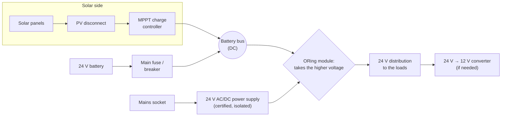

Some places have a grid, but it is unreliable or expensive. This design uses solar first, then the
battery, and takes power from the grid only when the battery runs low. Everything after the mains
socket is low-voltage DC, and there is **no inverter**. It suits loads that run on DC anyway: a
router, a small server, lights, laptops.

This is an **experimental design** from the wiki's owner. The parts are common, but the code does
not have rules for it yet.

:::caution
The mains side is only a plug-in power supply in a normal socket. Do not wire anything into the
building's mains wiring. The power supply must be a certified (listed) type with an isolated
output ([DIST-4.5](/code/earthing-and-surge/#dist-45-ac-equipment-must-be-isolated)). Anything
more needs a licensed electrician.
:::

## How it works

There are two sources: the solar side (panels, charge controller and battery) and a mains power
supply. An **ORing module** (also called a redundancy module) has two inputs and one output. It
connects whichever input has the higher voltage to the loads. It has no settings and no software.

The power supply never charges the battery. It only takes over the loads when the battery voltage
falls below the power supply's output voltage.

## The three modes

| Mode | When | What powers the loads |
|---|---|---|
| **Solar** | Daytime | The panels, through the charge controller. Extra energy charges the battery. No battery losses. |
| **Battery** | Night, or cloud | The battery, as long as its voltage is above the power supply's. |
| **Grid** | Battery low | The power supply. The battery waits for the sun. |

## Set the priority with the power supply's voltage

Most DIN-rail power supplies have a small screw to adjust their output voltage. That voltage
decides when the grid takes over. For a 24 V lithium iron phosphate (LFP) battery:

| Power supply set to | Behaviour | Use it for |
|---|---|---|
| 24.0 V | Grid takes over only when the battery is nearly empty | **Solar priority**: the most solar use, no reserve |
| about 25.6 V | Grid takes over around a quarter to half full | **Mixed**: solar first, but a reserve is kept for a grid outage |
| about 28 V | Grid supplies the loads most of the time; the battery is a backup | **Grid priority**: a DC UPS (uninterruptible power supply) |

An LFP battery's voltage is almost flat from full to nearly empty, and it reads lower under load
than at rest. These switching points are rough
([what the battery voltage tells you](/maintain/troubleshooting/#what-the-battery-voltage-tells-you)).

:::caution
Check every part's input range before you raise the power supply's voltage. A 24 V ORing module
or a 24 V device may accept only up to about 29 V. The power supply's output must also stay below
the battery's highest charging voltage, or the battery never takes over.
:::

## Sizing the battery

Size the battery between **half and all** of the energy the panels make on a typical day:

- Most use happens **during sunny hours** (a daytime office, a school): half is enough.
- Most use happens **after dark**: size toward the full day.

The grid covers what the battery cannot, so you do not need the extra days without sun that an
off-grid system needs ([Sizing panels and batteries](/plan/sizing-panels-and-batteries/)).

## Why no inverter

An inverter-based backup turns battery DC into AC, and then each device's own adapter turns it
back into DC. Each conversion loses energy, and the inverter uses power even when nothing runs:
about 8-10 W for a good small inverter, more for cheap ones. Over a day that can be hundreds of
watt-hours. In this design, solar power goes straight to the loads as DC.

The owner's rough comparison of overall efficiency:

| Path | Efficiency, roughly |
|---|---|
| Battery through an inverter, then back to DC | about 80 % |
| Battery mode (this design) | about 90 % |
| Solar mode (this design) | close to 100 % |

## Example part list

The owner's example, at retail prices in late 2025 (US dollars):

| Part | Qty | Each |
|---|---|---|
| Solar panel | 2 | $90 |
| MPPT charge controller | 1 | $60 |
| DC breakers | 2 | $20 |
| 24 V ORing module | 1 | $40 |
| 24 V LFP battery | 1 | $170 |
| 24 V power supply | 1 | $70 |
| **Total** | | **about $550** |

The owner estimates up to about 1 300 kWh of solar a year from this array, which is worth $390 a
year at $0.30 per kWh, or $780 at $0.60.

## A 48 V version

The same design works at 48 V. It is more efficient over longer cables and leaves room to grow,
but devices that need 24 V or 12 V then need a DC-DC converter each, and 48 V needs more care with
touch safety ([Choose a system voltage](/plan/choose-a-system-voltage/#touch-safety)).

## Without solar

With no panels, the same parts make a **DC power plant**: a DC UPS that keeps loads running in a
grid outage. The battery then needs its own charger (most MPPT controllers can charge from a DC
supply; check the manual). Stop charging once the battery is full, and give it a full charge at
least once a month so its cells stay balanced.
