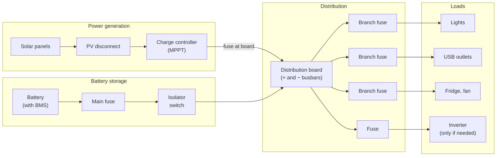

A DC solar system isn't complicated once you understand what each part does and how they fit
together. Every system has the same four parts, and [the code](/start-here/how-the-code-works/)
is organized the same way:

| Part | What it does | Includes |
|---|---|---|
| Power generation | Makes electricity | Panels, MPPT chargers; wind or water turbines are possible |
| Battery storage | Stores electricity | Batteries and their protection devices |
| Distribution | Connects everything | Wiring, switches, protection, outlets, distribution panels |
| Loads | Uses power | Lights, chargers, fans, computers, fridges, pumps |

Some devices cover more than one part. A power station, for example, has all four in one box.

## How the parts connect

Power flows from the panels and the battery into one shared point, the distribution board, and
from there out to the loads. Every cable that leaves a power source has a fuse at that source.

The negative wires return the same way, to a negative busbar on the board. How to lay out the
board and the branches: [Distribution wiring](/install/distribution-wiring/).

## Solar panels

Panels are the "income" side of the system. Everything starts with how much energy they bring in.

**Commodity full-size panels (400-500 W)**
These are the global standard now: best cost per watt, best long-term availability, best build
quality. Smaller 50-100 W "kit" panels are almost always worse value and tend to age faster.

**Panel voltage**
Panels don't output a fixed voltage. Two numbers matter:

- **Vmp** (voltage at maximum power): usually about 34-38 V for a 400-500 W panel.
- **Voc** (open-circuit voltage): the highest the panel reaches in cold, bright sun, usually
  about 45-50 V.

These matter for choosing the MPPT charger, not for your loads.

**Mounting and shading**
Panels hate shade. Even a hand-sized obstruction can drop power dramatically. A perfect panel in
the wrong place performs worse than a mediocre panel in clean sun.

## MPPT charge controllers

The MPPT (maximum power point tracker) is the bridge between the panel and the battery. It keeps
adjusting the panel voltage to find where the panel makes the most power, then converts that
down to the battery voltage efficiently.

Cheap PWM controllers skip this step and waste a large part of the panel's output. Avoid them for
anything bigger than a small kit.

**Sizing**
Match the MPPT output current to your battery voltage and panel wattage. A 450 W panel charging
a 24 V battery needs about 20 A of output headroom.

## Batteries

The battery is the system's energy bank. Pick it carefully, because everything else revolves
around it.

- **LiFePO₄ is the standard for off-grid:** safe, long-lasting, stable, and available worldwide.
- **Voltage:** 24 V for homes. See [Choose a system voltage](/plan/choose-a-system-voltage/).
- **Capacity:** 2.0-2.5 kWh covers minimal home needs; 5 kWh is a comfortable home system;
  5-10+ kWh is community or multi-room scale.

## Distribution

Once you power more than a single light or phone charger, you need a clean way to **split power
safely**. That is all "distribution" means. It is the same idea as a small breaker panel in a
house, just simpler and sized for low-voltage DC.

A good distribution setup solves three problems:

1. **You will have more than one device to power.** Even the smallest home system ends up with
   lights, a fan, a router, and a place to charge phones. Running everything straight from the
   battery leads to a tangle of wires and loose connections. Distribution gives you one
   organized place to connect all those loads.
2. **Each device needs its own protection.** If one cable gets damaged or one device shorts
   out, you want that circuit to shut off, not the entire system. Distribution gives each output
   its own fuse or switch, so problems stay isolated and easy to fix.
3. **It keeps the system neat, safe, and easy to understand.** Anyone in the household who needs
   to troubleshoot should be able to open the distribution area and see where power comes in,
   where it goes, and which branch controls which device. Labels matter. Clear wiring matters.

At its core, a DC distribution board is a **hub**: one input from the battery, several outputs
for your devices, each with basic protection so nothing gets overloaded.

**If your system powers more than one device, you need distribution.**

## Loads: what you actually power

Loads decide everything upstream. The battery, MPPT and panel count all follow from what you
need to run each day.

| Load | Notes |
|---|---|
| Lights | The cheapest, easiest DC load. 12 V LED bulbs or RV-style lights are cheap, efficient and available everywhere. |
| Phones, laptops, tablets | USB-C PD makes this easy. No inverter needed. |
| Fans | 24 V DC fans are efficient and cheap. A big comfort upgrade for little energy. |
| Computers, mini PCs | A 10-25 W mini PC suits remote work or community centres. Low idle power means much longer battery life. |
| Refrigeration | The tipping point. See [the fridge problem](/plan/energy-and-load-budgets/#the-fridge-problem). Small DC fridges exist but are expensive; AC fridges need careful management or an inverter that switches on only when needed. |
| Water pumps | Surge currents, lift height limits, and a need for stable power. 48 V is almost always the right choice. |
