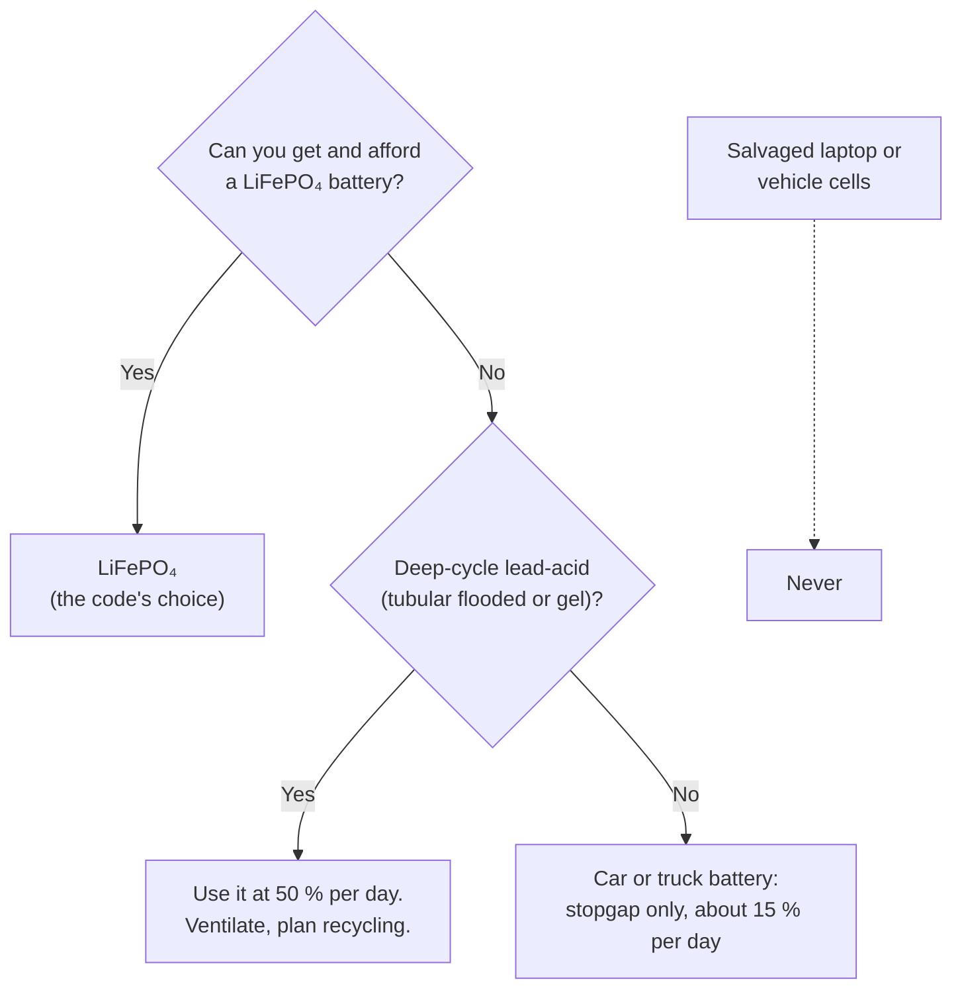

The code names the best common part for each job. In many places that part is not sold, or costs
too much. This page gives the next-best choice, what it costs you, and what to do so it stays safe.
The rules allow this: most part choices are **should** rules, so a different part is fine **with
the reason written in the system documents** ([How the code works](/start-here/how-the-code-works/#how-a-rule-reads)).

## Quick guide

| Recommended | If you cannot get it | Never |
|---|---|---|
| LiFePO₄ battery ([STO-1.1](/code/battery-pack/#sto-11-lithium-iron-phosphate)) | Deep-cycle lead-acid: tubular flooded or gel. A car or truck battery only as a stopgap. | Home-made packs from salvaged laptop or vehicle cells |
| MPPT charge controller ([GEN-2.1](/code/charge-controller/#gen-21-mppt-above-size-a)) | PWM controller, for small systems with a matched panel | A controller with no battery-type setting for your battery |
| Fine-stranded copper cable | Single-core flexible cable in conduit; solid wire only in fixed conduit runs ([details](/install/distribution-wiring/#when-parts-are-hard-to-find)) | Copper-clad aluminium (CCA), unmarked speaker wire |
| DC-rated fuses and fuse holders | Automotive blade fuses (32 V) from an auto-parts shop, at 12 V and 24 V | Glass fuses with no DC rating; wire or foil in a fuse holder; AC-only breakers |
| DC outlets of one family per voltage | Any polarised, latching DC connector, the same one throughout | Mains (AC) sockets and plugs for DC ([DIST-3.1](/code/connectors-and-outlets/#dist-31-one-connector-family-per-voltage)) |
| Efficient DC appliances | AC appliances through a good inverter, used on a schedule | "Solarised" AC appliances rewired for DC by someone without the maker's design |

## Batteries

### Lead-acid instead of LiFePO₄

Lead-acid is still the battery most people can buy: most off-grid systems in sub-Saharan Africa
use it. It works, but it is a different battery and must be sized and housed differently.

| | LiFePO₄ | Deep-cycle lead-acid (tubular, gel) | Car or truck battery |
|---|---|---|---|
| Use per day | up to 80 % | **50 %** | **about 15 %** |
| Battery for 1 kWh used a day | about 1.25 kWh | about **2 kWh** | about **7 kWh** |
| Cycles (maker's figures) | 2 500 at 80 % | 750 (gel, 50 %) to 1 500 (good tubular, 80 %) | few: built for starting, not cycling |
| Weight per kWh | about 11 kg | about 25-32 kg | heavy |
| Heat | life halves for about each 10 °C above design temperature | AGM float life: 7-10 years at 20 °C, **2 years at 40 °C** | worse |
| Upkeep | none | flooded: add distilled water; gel: none | add water |
| Gas | none in normal use | flooded gives off hydrogen when charging | hydrogen |

Lifetime cost is disputed. On one Indian maker's own figures, a good tubular battery and a LiFePO₄
pack cost about the same per kWh delivered over their lives. In heat, with partial charging, and
counting the extra weight to carry to remote sites, lead-acid usually ends up costing more. A
cheap car battery used daily costs far more: it may last months.

**Car and truck batteries.** IEC TS 62257-341 gives simple tests to decide which locally made car or
truck batteries are acceptable for solar use, so they are not ruled out. But they are built to give
a short burst for starting an engine. Use one only as a **stopgap** for Size A or a first Size B
system, sized so a day's use is about 15 % of its capacity, and replace it with a deep-cycle or
LiFePO₄ battery when it fails.

### If you use lead-acid

:::danger
Flooded lead-acid batteries give off hydrogen when charging, which can explode, and contain
sulphuric acid, which burns skin and eyes. Wear gloves and eye protection. No flames, smoking or
sparks near the battery. Never add acid: add only distilled water.
:::

1. **Set the charge controller for lead-acid** of the right type (flooded, AGM or gel). A lithium
   setting will ruin it, and the reverse.
2. **Do not equalise a 24 V flooded battery while loads are connected.** Equalising raises a 24 V
   battery to about 32.4 V, above what 24 V devices accept. Switch the loads off first, or do not
   equalise. Never equalise AGM or gel.
3. **Ventilate.** A flooded battery needs air in low and out high. The Pacific installation
   guideline sizes each opening as: area (cm²) = 100 × 0.006 × number of cells × largest charging
   current (A). For a 24 V flooded battery (12 cells) on a 20 A controller: 100 × 0.006 × 12 × 20 =
   **144 cm²** for each opening, for example 12 × 12 cm.
4. **Contain the acid.** Stand the battery in an acid-resistant tray. Keep water, baking soda and
   eye-wash nearby. Keep children away.
5. **Nothing above the battery**, and no switching or fuse-changing where gas can collect.
6. **Battery placement rules still apply** ([STO-3](/code/battery-placement/)).
7. **Two 12 V batteries for 24 V** is normal for lead-acid. Use the same make, model and age,
   bought together, and check each battery's voltage at every regular check
   ([One native pack or two in series](/plan/choose-a-system-voltage/#one-native-pack-or-two-in-series)).
8. **Plan the end of life before you buy** (below).

### Recycling lead-acid

Lead is poisonous at any level, and children absorb far more of it than adults. Informal recycling
of lead-acid batteries is a leading cause of lead poisoning: UNICEF and Pure Earth estimate up to
800 million children have high blood lead, and up to half of lead-acid batteries in low- and
middle-income countries are recycled unsafely. Backyard smelting loses up to half of the lead into
the air and soil.

- Write in the system documents where the old battery goes: the seller (ask for take-back when you
  buy) or a licensed recycler.
- Never break, burn or melt a battery at home, and never let it be sold to a backyard smelter.

### Never: packs from salvaged cells

Packs built from used laptop cells (18650s) or salvaged vehicle modules are cheap, but each cell
has an unknown history. A UK government study found second-life cells may fail more often, that a
sample does not show the quality of the batch, and that every battery needs its own assessment.
Salvaged markets also sell relabelled fakes: one "10 000 mAh" cell measured about 500 mAh. The
code does not accept these packs as the system battery. Buy a certified new LiFePO₄ pack, or use
lead-acid as above.

## Charge controllers: PWM instead of MPPT

A PWM controller connects the panel straight to the battery, so the panel works at the battery's
voltage, not its best voltage. Victron's comparison: at 25 °C panel temperature a PWM controller
gives about **19 % less** than MPPT; at 75 °C (a hot panel in the tropics) they are about equal.

PWM is acceptable when **all** of these are true:

- The system is small: one small panel ([Size A](/plan/system-sizes/#size-a-kit)), or a small
  Size B.
- The panel matches the battery: **36 cells for 12 V, 72 cells for 24 V**. Modern 400-500 W panels
  (Vmp about 34-38 V) are not matched to 12 V and waste a large part of their power on PWM.
- The site is warm, and the cable from the panel is short.

Check that a controller sold as MPPT really is one: see [Buying parts](/plan/buying-parts/#checks-before-you-pay).

## Fuses and breakers

- **Auto-parts shops sell good DC fuses.** Blade fuses (rated 32 V DC) and their holders suit 12 V
  and 24 V systems. They do not suit 48 V.
- **Glass fuses** often have no DC rating. Use them only if the DC rating at your voltage is
  printed on the fuse or its datasheet.
- **Never** replace a fuse with wire, foil or a bigger fuse
  ([DIST-1.2](/code/overcurrent-protection/#dist-12-fuse-no-bigger-than-the-wire)).
- **The main battery fuse has no cheap substitute.** It must break the battery's short-circuit
  current ([STO-2.2](/code/battery-fuse-and-isolator/#sto-22-interrupt-rating-above-the-batterys-short-circuit-current)).
  Buy it from a known maker, even if everything else is local.

## Appliances

Efficient DC appliances cost more to buy, but they need a smaller panel and battery: a solar home
system with super-efficient appliances can be up to 35 % cheaper for the same service. Where they
are not sold:

- **Lights and USB charging** are easy everywhere: 12-24 V LED bulbs and USB-C outlets.
- **AC appliances through an inverter** work, but the inverter uses power even when idle. Switch
  the inverter on only when needed ([LOAD-1.4](/code/outputs-and-loads/#load-14-inverters),
  [the fridge problem](/plan/energy-and-load-budgets/#the-fridge-problem)).
- **"Solarised" AC appliances** (rewired for DC by a local technician) are common in some markets.
  Their safety and efficiency are unknown. Prefer a tested DC appliance or an inverter.

## Write it down

Every substitute goes in the system documents with its reason: "Lead-acid tubular battery, 2 × 12 V
150 Ah: LiFePO₄ not sold locally. Take-back at the seller." The next installer then knows what they
are looking at ([SYS-2.1](/code/labels-and-documents/#sys-21-wiring-diagram)).
