Without changing the way the home is built, it can be electrified. This page follows one
household through a day, then shows the numbers.

## The story

A light comes on in the main room for cooking after sunset. In the evening, children study at the
same table where meals are eaten during the day. Phones and small electronics charge from one spot
along the wall. If the family chooses, a satellite internet unit can run for a few hours at a time.

At night, mats are laid out on the floor for sleeping. A dim light stays on so people can move
safely without tripping or waking others. On hot nights, a fan runs while people sleep. These few
uses (light, charging, airflow and communication) cover most daily needs.

All of this runs from **one solar panel** placed on the ground beside the home. It is easy to
reach, easy to clean and easy to repair. It does not touch the roof, so there is no risk of leaks.
During the day the panel gathers sunlight and stores enough energy for the night.

That energy is kept in **a small battery** inside the home. It holds about a day's worth of normal
use. When the sun sets, the stored energy takes over. Nothing needs to be switched. There is no
fuel to buy, no noise and no daily maintenance.

Power inside the home is kept simple. There is no wiring hidden in walls. Electricity goes only
where it is needed: lights, a few outlets, and nothing more. If something breaks, it can be
understood and fixed without shutting down the whole system.

This is not a system meant to run everything. It runs the first things that change daily life:
light at night, the ability to learn, the ability to communicate, and a little comfort. One panel.
One battery. One room, used from morning to night.

## The day, hour by hour

```mermaid
gantt
  title What runs when
  dateFormat HH:mm
  axisFormat %H:%M
  todayMarker off
  section Sun
  Panel charges the battery   :07:00, 11h
  section Light
  Main light                  :active, 18:00, 5h
  Night light                 :22:00, 9h
  section Comfort
  Fan                         :22:00, 8h
  section Charging and internet
  Phones                      :18:00, 4h
  Satellite internet          :19:00, 3h
```

## The numbers

Energy = power × hours. Figures are typical measured or maker values; your devices may differ.

| Device | Power | Hours a day | Energy a day |
|---|---|---|---|
| Main light (LED, about 900 lumens) | 9 W | 5 h | 45 Wh |
| Night light (small LED) | 1 W | 9 h | 9 Wh |
| 3 phones, one full charge each | about 14 Wh each | | 43 Wh |
| Fan (12 V pedestal type) | 15 W | 8 h | 120 Wh |
| Satellite internet (small dish) | 30 W | 3 h | 90 Wh |
| **Total** | | | **about 310 Wh** |
| With 10 % lost in wiring and converters | | | **about 340 Wh** |

The night light's 1 W is an estimate for a small LED. The fan is the biggest user: on cool nights
the total falls to about 200 Wh.

## What that needs

Using the method of the [System estimator](/plan/system-estimator/):

- **Battery:** 340 Wh for one day without sun, used to 80 % = about **430 Wh**. A 24 V, 20-25 Ah
  lithium iron phosphate battery (about 500-600 Wh) covers it with a little spare.
- **Panel:** 340 Wh ÷ (5 sun hours × 0.75 × 0.92) = about **100 W**. A single modern 400-500 W
  panel gives about four times that, so the battery refills even on a cloudy day, and there is
  room to add a second fan or a laptop later.

That puts this household between [Size A and Size B](/plan/system-sizes/). With a full-size panel
and a 24 V battery, it is built as Size B from the start, so it can grow without tearing anything
out.

## Next

- [Parts of a system](/plan/parts-of-a-system/): what each box does.
- [Energy and load budgets](/plan/energy-and-load-budgets/): add up your own devices.
- [System estimator](/plan/system-estimator/): get a battery and panel size from your list.
