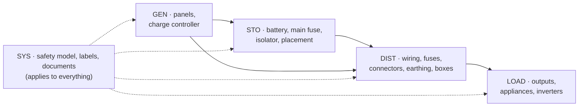

This wiki is growing into a **code**: a short set of numbered rules for small DC solar systems,
like a wiring code but written for picogrids. A community can build to it, and someone else can
check the result against it.

## What it is based on

| Kind | Sources | How we use them |
|---|---|---|
| **Guiding regulations** | IEC TS 62257 (renewable energy systems for rural electrification); IEC 62368-1 (hazard-based safety) | The structure and the safety model. A rule here never asks for less than they do. |
| **Industry norms** | Victron Energy's guidance, marine practice (ABYC, ISO small craft) | Proven practice for low-voltage DC and lithium batteries, where the regulations leave detail open. |
| **Field practice** | Van and RV builders, off-grid communities | Ideas and lessons. Useful, but amateurs: never the only source for a rule. |

Every rule lists its sources. See [Standards and sources](/reference/standards/) for what each
one covers.

## The parts of the code

Every system splits into the same parts, and each rule ID starts with its part.

| Part | Covers | Rule IDs |
|---|---|---|
| System | The safety model, labels, documents, install modes | `SYS-` |
| Power generation | Panels, charge controllers | `GEN-` |
| Battery storage | Battery, its protection, main fuse, isolator, placement | `STO-` |
| Distribution | Wiring, fuses and breakers, connectors, outlets, earthing, enclosures | `DIST-` |
| Loads | Outputs, appliances, inverters | `LOAD-` |

## How a rule reads

Each rule has an ID that never changes or gets reused, for example `STO-2.1`.

- **must**: required. A system that breaks a "must" rule does not meet the code.
- **should**: recommended. Break it only with a good reason, and write the reason down.

Every rule gives its reason and its source. Guide pages link to rule IDs instead of repeating
the rule, so each rule has one home.
