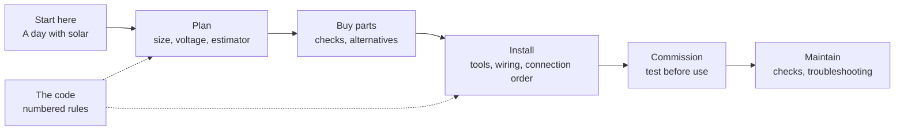

This wiki helps you set up a **small off-grid solar power system**: one or a few solar panels,
a charge controller, a battery, and the things you want to run from it, such as lights, a
Wi-Fi router, a security camera or phone chargers. It covers 12 V and 24 V systems that store up
to about 5 kWh: from a kit for one room to a home with a fridge.

## How the pages work

- **Follow the sidebar in order** the first time: plan, choose parts, install, then read the
  safety pages before you connect a battery.
- **Every page lists its sources** at the bottom: standards, manufacturer manuals and safety
  bodies. Check the numbers against your own parts' manuals.
- **A "Draft" banner** means the page has not been checked against its sources yet. Do not
  build from a draft page.

:::caution
Wiring rules differ by country, and a mistake with a battery can start a fire. This wiki is
general guidance, not a substitute for your local rules or a licensed electrician. If your
system connects to a building's mains wiring, get an electrician.
:::

## Help improve it

This wiki is open source. Use **Edit page** at the bottom of any page to suggest a fix.
